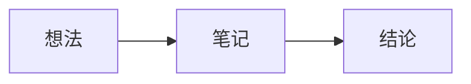

# 笔记 / Note

> [!TIP] 怎么用 / How to use
> 1. 尖括号「<>」里是提示，替换成自己的内容后把尖括号一并删掉。 / Words in angle brackets are hints — replace them and delete the brackets.
> 2. 每个 `##` 小节都可以整段删掉、改名或复制，模板只是起点。 / Every `##` section can be deleted, renamed or copied; the template is only a starting point.
> 3. 不会写语法就用「格式」菜单或快捷键，编辑器会替你补 Markdown。 / No syntax needed: the Format menu and shortcuts write the Markdown for you.

## 背景 / Background

- 为什么记这条 / Why this note exists：把 <零散的想法> 集中到一处
- 相关信息 / Related：项目笔记 `project.md`、会议记录 `meeting.md`

## 要点 / Key points

1. <第一条要点，可以是一句完整的话>
2. <第二条要点>
3. <第三条要点>

## 结论与下一步 / Conclusion & next steps

- 结论 / Conclusion：<先写结论，再写理由>
- 下一步 / Next step：<周五前整理成三页说明>

## Markdown 速查 / Cheat sheet

按 `Ctrl + /` 可切换到源码视图查看真实 Markdown；下面每一项都能直接抄。

### 标题与强调 / Headings & emphasis

- 标题：`#` 到 `######`，最多六级，`#` 后面留一个空格
- **加粗**、*斜体*、~~删除线~~、`行内代码`
- 引用：行首写 `> ` 再写内容

### 链接与图片 / Links & images

- 标准链接写法：`[文字](https://example.com)`
- 也可以直接粘贴裸地址，例如 https://example.com ；保存时会自动写成标准链接，不会留下 `< >` 记号
- 图片写成 ``；把图片拖进编辑器会自动保存到 attachments/

### 列表与任务 / Lists & tasks

- 无序列表行首写 `- `，有序列表行首写 `1. `，按 Tab 缩进成子项
- 任务有三种状态，在编辑器里点方框即可切换：

- [ ] 待办示例 / Todo
- [~] 进行中示例 / In progress
- [x] 已完成示例 / Done

### 表格 / Table

行列之间用竖线分隔，第二行写 `---` 定表头：

| 项目 / Item | 说明 / Detail | 状态 / Status |
| --- | --- | --- |
| <项目 A> | <一句话说明> | 进行中 |
| <项目 B> | <一句话说明> | 已完成 |

### 代码块 / Code block

用三个反引号开头、三个反引号结尾，开头那行后面写上语言名即可高亮：

```ts
export function greet(name: string): string {
  return `Hello, ${name}`
}
```

### 公式 / Math

行内公式写在两个美元符号之间：$a^2 + b^2 = c^2$

块级公式用两对美元符号单独成段：

$$
\int_0^1 x^2 \, dx = \tfrac{1}{3}
$$

### 图表 / Mermaid

把代码块语言写成 `mermaid`，编辑器会实时渲染：



### 提示块 / Callout

第一行写成 `> [!TIP] 标题` 即可；`TIP`、`INFO`、`SUCCESS`、`WARNING`、`DANGER` 各有配色：

> [!WARNING] 注意 / Heads up
> 提示块里的每一行都要以 `>` 开头，否则会变成普通段落。

---

下一步 / Next：把这篇笔记的标题改成 <真正要做的事>，然后删掉本行。
