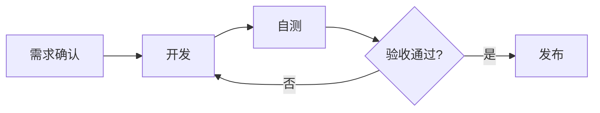

# 项目名称 / Project Name

> [!TIP] 怎么用 / How to use
> 1. 尖括号「<>」里是提示，替换成自己的内容后把尖括号一并删掉。 / Words in angle brackets are hints — replace them and delete the brackets.
> 2. 第一段永远写「交付什么、谁验收」，说不清就先别开工。 / Always start with what gets delivered and who signs it off.
> 3. 决策、风险各用一张表或清单，下次开会直接照着念。 / Keep decisions and risks as a table or a list you can read out loud in the next meeting.

> <一句话说明这个项目要交付什么 / One sentence on what this project delivers>

## 目标与验收 / Goal & acceptance

- 目标 / Goal：<把导出流程压到三步以内，普通用户不用看文档>
- 验收标准 / Definition of Done：
  1. <导出对话框能按页码范围输出 PDF>
  2. <附件缺失时给出明确提示而不是空白页>
  3. <编辑和设计各验收一次>

## 里程碑 / Milestones

- [x] <11-20 需求确认，范围冻结>
- [~] <11-27 功能完成，进入验收>
- [ ] <12-04 打包发布 0.7.0>

## 任务拆分 / Tasks

- [ ] <补页码范围校验与错误提示>
- [ ] <整理导出模板的样式变量>
- [~] <写发布说明，含迁移提示>
- [x] <确认附件收集逻辑>

## 关键决策 / Decisions

| 日期 / Date | 决策 / Decision | 原因 / Why |
| --- | --- | --- |
| <11-21> | <链接统一输出 `[文字](url)`> | <标准形式在其它编辑器里不会变形> |
| <11-22> | <模板文件名改用英文> | <避免中文名在部分系统上乱码> |

## 流程 / Flow

## 风险与问题 / Risks & issues

| 风险 / Risk | 影响 / Impact | 应对 / Mitigation |
| --- | --- | --- |
| <分页宽度依赖主题> | <更换主题后页码会变> | <把宽度抽成主题变量> |
| <WebView2 快捷键差异> | <桌面端个别组合键失效> | <发布前在真机复测> |

## 资料 / References

- <[项目说明](https://example.com/project)>
- <设计稿：`attachments/design-0-7.png`>

## 复盘 / Retro

- 做得好的 / Went well：<范围冻得早，返工少>
- 下次改进 / Improve：<模板应该先给新人用一遍再定稿>
